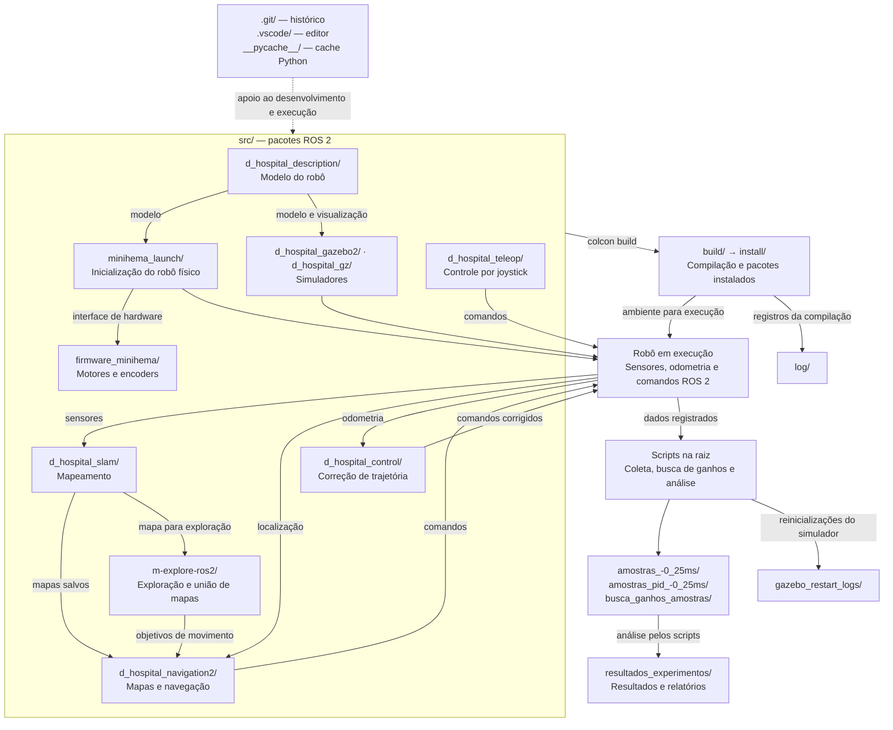

# Repository directories

This repository is a ROS 2 workspace for Mini Hema, a hospital robot designed to transport laboratory samples. It contains robot software, simulation assets, and data from motion-control experiments.

## Visão das conexões

O diagrama resume as relações funcionais entre os diretórios; as setas indicam uso ou fluxo de dados, sem representar todas as dependências de compilação. O robô físico e os dois simuladores são alternativas de execução.

Dentro dos pacotes, `launch/` carrega `config/` e inicia os nós implementados em `src/`, `include/` ou módulos Python. Os nós usam os recursos de `urdf/`, `meshes/`, `worlds/`, `models/` e `maps/` conforme sua função. Os diretórios locais de `build/`, `install/` e `log/` em `d_hospital_slam/` seguem o mesmo fluxo de compilação mostrado acima.

## Source packages (`src/`)

| Directory | Purpose |
| --- | --- |
| `d_hospital_description/` | Robot geometry and visualization: URDF/Xacro models, meshes, controller configuration, and RViz settings. |
| `d_hospital_gazebo2/` | Gazebo Classic simulation, including hospital and test worlds, launch files, and obstacle-avoidance code. |
| `d_hospital_gz/` | Gazebo Fortress simulation with robot models, worlds, and ROS–Gazebo bridge configuration. |
| `d_hospital_control/` | Python PID controller that uses odometry to correct lateral drift during straight-line movement. |
| `d_hospital_navigation2/` | Nav2 navigation and localization launch files, saved maps, configuration, and trajectory visualization. |
| `d_hospital_slam/` | SLAM launch files, mapping parameters, and RViz settings for building maps. |
| `d_hospital_teleop/` | Joystick control and velocity-command multiplexing configuration. |
| `firmware_minihema/` | Motor and encoder drivers, plus the robot's ROS 2 hardware interface. |
| `minihema_launch/` | Robot startup and sensor integration, including camera, RPLIDAR, and MPU6050 IMU support. |
| `m-explore-ros2/` | A separate Git checkout providing frontier exploration, exploration messages, and multi-robot map merging. |

Within packages, `launch/` starts nodes, `config/` stores parameters, `urdf/` and `meshes/` describe the robot, `worlds/` and `models/` contain simulation assets, and `maps/` holds saved maps. Package-local `src/`, `include/`, and Python module directories contain implementation code.

## Other workspace directories

| Directory | Purpose |
| --- | --- |
| `amostras_-0_25ms/` | Recorded ROS bags and metadata for open-loop movement experiments at −0.25 m/s. |
| `amostras_pid_-0_25ms/` | Recorded ROS bags and metadata for equivalent experiments using the PID controller. |
| `busca_ganhos_amostras/` | Experiment recordings collected while searching for controller gains. |
| `resultados_experimentos/` | Experiment outputs, including robot/world settings and consolidated reports. |
| `gazebo_restart_logs/` | Logs from restarting Gazebo during experiments. |
| `build/`, `install/`, `log/` | Generated colcon build files, installed packages and environment scripts, and build logs. These also appear inside `src/d_hospital_slam/`. |
| `.vscode/` | Local editor settings. |
| `__pycache__/` | Generated Python bytecode caches. |
| `.git/` | Repository history and Git metadata. |

The scripts in the repository root launch the robot or simulation, collect experiments, search PID gains, and analyze odometry and bag metrics.
