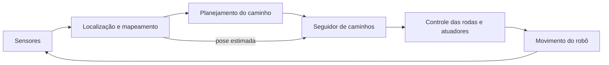

# Roteiro para desenvolver o controle de trajetórias do Mini-Hema

## Objetivo

Evoluir do controlador atual de trajetória retilínea para um sistema capaz de seguir caminhos com curvas, controlar a velocidade e concluir o movimento com precisão. Depois, integrar esse controle à navegação com o Nav2 e avaliar os resultados para um artigo científico.

Este roteiro complementa [RECOMENDACOES_PESQUISA.md](RECOMENDACOES_PESQUISA.md). As etapas abaixo são propostas de desenvolvimento; não representam funcionalidades já implementadas ou resultados validados.

## 1. Estudar a base matemática

**Fonte:** [Introduction to Robotics and Perception — capítulo 5](https://www.roboticsbook.org/S50_diffdrive_intro.html), de Frank Dellaert e Seth Hutchinson.

Estudar a cinemática de robôs diferenciais, a representação da pose `(x, y, θ)` e a transformação entre coordenadas do mundo e do robô. Relacionar as velocidades das rodas à velocidade linear `v` e angular `ω`:

```text
v = r · (ωdireita + ωesquerda) / 2
ω = r · (ωdireita - ωesquerda) / L
```

Aqui, `r` é o raio das rodas e `L` é a separação entre elas. A conversão inversa é:

```text
ωdireita = (v + ω · L / 2) / r
ωesquerda = (v - ω · L / 2) / r
```

No repositório, a camada de hardware ou o plugin de simulação pode realizar essa conversão. O seguidor de caminhos deve produzir comandos de velocidade compatíveis com a camada efetivamente usada.

**Entrega:** uma descrição do modelo cinemático e dos referenciais adotados, com unidades e convenções de sinal.

**Critério de avanço:** compreender como movimento para frente, de ré e rotação no lugar aparecem nas velocidades das rodas e nos comandos ROS 2.

## 2. Consolidar a referência atual de controle

Antes de adicionar curvas, resolver os pontos de arquitetura descritos nas recomendações de pesquisa:

- Separar odometria bruta e filtrada e confirmar qual alimenta cada controlador.
- Definir um único responsável por cada transformação TF.
- Corrigir o cálculo do desvio lateral e do avanço para funcionar com qualquer orientação inicial.
- Parar o robô quando a pose estimada estiver vencida.
- Padronizar parâmetros e registrar a configuração efetiva dos experimentos.
- Separar a correção lateral da política de parada por tempo ou distância.

Preservar o PD atual como referência experimental para trajetórias retilíneas. Com `Ki = 0`, descrevê-lo como PD com termo de orientação, mesmo que o nome do pacote mantenha a referência a PID.

**Entrega:** ensaios de reta reproduzíveis, com dados brutos, configuração e motivo de término.

**Critério de avanço:** o fluxo de realimentação estar documentado e os erros serem calculados corretamente em orientações iniciais diferentes.

## 3. Aprender o Pure Pursuit

**Fonte principal:** [Implementation of the Pure Pursuit Path Tracking Algorithm](https://publications.ri.cmu.edu/storage/publications/pub_files/pub3/coulter_r_craig_1992_1/coulter_r_craig_1992_1.pdf), de R. Craig Coulter, relatório técnico CMU-RI-TR-92-01.

O Pure Pursuit seleciona um ponto à frente no caminho e calcula uma curvatura para alcançá-lo. Estudar:

- Transformação do ponto-alvo para o referencial do robô.
- Seleção do ponto de acompanhamento e progressão ao longo do caminho.
- Distância de antecipação, ou *lookahead*.
- Relação entre curvatura, velocidade linear e velocidade angular.
- Influência do *lookahead* na resposta e na suavidade.

Para um ponto-alvo `(x_alvo, y_alvo)` no referencial do robô, uma formulação geométrica comum é:

```text
d² = x_alvo² + y_alvo²
curvatura = 2 · y_alvo / d²
ω = v · curvatura
```

Essa expressão exige distância não nula e convenções de referencial consistentes. Ela é o núcleo geométrico, não um controlador completo: seleção do alvo, limites, chegada ao objetivo e movimento de ré precisam de tratamento explícito.

**Entrega:** uma implementação matemática simples, capaz de calcular o comando para poses e alvos conhecidos.

**Critério de avanço:** os sinais dos comandos fazerem sentido para alvos à esquerda e à direita, sem divisão por zero ou comandos inválidos.

## 4. Implementar um primeiro seguidor de caminhos em Python

Começar com um nó ROS 2 independente para facilitar o aprendizado e os experimentos. A integração como plugin do Nav2 virá depois.

### Entradas e saída propostas

| Interface | Função |
| --- | --- |
| `nav_msgs/Path` | Caminho de referência, composto por poses e identificado por um referencial. |
| Pose estimada/odometria e TF | Posição e orientação atuais do robô no referencial necessário. |
| Parâmetros ROS 2 | Velocidade desejada, *lookahead*, limites e tolerâncias. |
| Comando de velocidade | Velocidades linear e angular para a interface usada no projeto. |

Confirmar os tópicos e o tipo de mensagem de comando usados no Humble e na arquitetura do repositório. Garantir que apenas o controlador selecionado comande o movimento durante o ensaio.

### Sequência do ciclo de controle

1. Verificar se o caminho e a pose estão disponíveis e válidos.
2. Colocar a pose e o caminho em referenciais consistentes.
3. Identificar o trecho correspondente à progressão atual do robô.
4. Selecionar um ponto à frente usando o *lookahead*.
5. Transformar o alvo para o referencial do robô.
6. Calcular curvatura e comando angular.
7. Aplicar limites e publicar o comando.
8. Detectar chegada, cancelamento ou falha e publicar parada.

Evitar escolher simplesmente o ponto globalmente mais próximo a cada ciclo: em caminhos que se cruzam, isso pode trocar o trecho seguido. Manter uma noção de progressão e tratar explicitamente a substituição do caminho.

**Entrega:** nó capaz de seguir um caminho simples em simulação, acompanhado de parâmetros e instruções de execução.

**Critério de avanço:** seguir uma reta e um arco com comandos válidos e parar corretamente ao terminar ou perder a realimentação.

## 5. Validar com caminhos progressivamente mais difíceis

| Ensaio | O que verificar |
| --- | --- |
| Reta alinhada ao eixo X | Comparação com o PD atual e estabilidade básica. |
| Reta com orientação inicial diferente | Correção das transformações e do referencial da trajetória. |
| Arco circular | Seguimento de curvatura e efeito do *lookahead*. |
| Caminho em S | Mudanças de sinal da curvatura e suavidade dos comandos. |
| Trechos retos conectados por curvas suaves | Transições entre segmentos. |
| Pose inicial fora do caminho | Capacidade e limites de convergência. |
| Caminho curto e chegada ao objetivo | Seleção do alvo quando resta menos caminho que o *lookahead*. |

Começar com movimento para frente e baixa velocidade. Tratar movimento de ré como uma extensão explícita, com seleção de alvo e convenções de sinal próprias. Não presumir que apenas inverter `v` resolve todos os casos.

Não avaliar uma quina abrupta como se fosse uma curva contínua executável a velocidade constante. Definir se o robô deve parar e girar ou seguir uma conexão suavizada.

**Entrega:** gráficos de trajetória real e referência, erros ao longo do percurso e comandos de velocidade.

**Critério de avanço:** comportamento estável nas condições declaradas e falhas registradas com causa ou hipótese verificável.

## 6. Completar o comportamento de execução

Adicionar progressivamente:

- Limites de velocidade linear e angular coerentes com a plataforma.
- Rampas e limites de aceleração e desaceleração.
- Redução da velocidade em curvas e perto do objetivo.
- Tolerâncias de posição e, quando exigido, orientação final.
- Tratamento de caminho vazio, alvo próximo demais, transformações indisponíveis e pose vencida.
- Cancelamento, substituição do caminho e parada ao encerrar o nó.
- Registro do estado do controlador e do motivo de término.
- Visualização do alvo escolhido e do trecho seguido.

Definir os estados de execução, por exemplo: aguardando dados, seguindo caminho, aproximando-se do objetivo, concluído e falha. Atingir a posição final e atingir uma orientação final específica são requisitos distintos.

**Entrega:** seguidor com execução previsível, diagnóstico e conclusão explícita.

**Critério de avanço:** demonstrar tanto os casos de sucesso quanto as respostas a perda de dados, cancelamento e condições inválidas.

## 7. Estudar e comparar o Regulated Pure Pursuit

**Fontes:**

- [Regulated Pure Pursuit for Robot Path Tracking — artigo](https://arxiv.org/abs/2305.20026).
- [Documentação oficial do pacote — versão Iron](https://docs.ros.org/en/iron/p/nav2_regulated_pure_pursuit_controller/standard_docs/README.html).
- [Guia de seleção e ajuste de controladores do Nav2 — Rolling](https://docs.nav2.org/rolling/configuration_and_development/tuning_guide/).

O Regulated Pure Pursuit acrescenta mecanismos de regulação de velocidade, antecipação adaptativa e verificação de possíveis colisões. É compatível com robôs diferenciais e oferece uma implementação de referência no Nav2.

**Ações:**

- Estudar as diferenças em relação ao Pure Pursuit básico.
- Verificar a implementação e os parâmetros disponíveis na instalação Humble do projeto.
- Configurá-lo como referência prática para comparação com o controlador desenvolvido.
- Avaliar precisão, suavidade e conclusão do caminho sob condições equivalentes.

O controle de seguimento não substitui toda a navegação. Verificação de colisão ou redução de velocidade perto de obstáculos também não equivalem, por si só, a desviar deles e encontrar um novo caminho.

**Entrega:** comparação documentada entre implementação própria e controlador de referência.

## 8. Integrar o controlador ao Nav2

**Fonte:** [Writing a New Controller Plugin — tutorial oficial, versão Jazzy](https://docs.nav2.org/jazzy/tutorials/plugin_tutorials/writing_new_controller_plugin/writing_new_controller_plugin/).

O tutorial usa Pure Pursuit para explicar como implementar um plugin de controle. Depois de validar a lógica no nó Python, estudar a interface `nav2_core::Controller`, os estados de ciclo de vida, o recebimento do caminho e a geração dos comandos. O exemplo de plugin é em C++.

Há duas rotas possíveis:

| Rota | Quando usar |
| --- | --- |
| Configurar o Regulated Pure Pursuit existente | Quando o objetivo imediato é obter seguimento de caminhos integrado ao Nav2 e uma referência funcional. |
| Desenvolver um plugin próprio | Quando a pesquisa exige alterar a lei de controle ou incorporar um comportamento específico e avaliar essa contribuição. |

O repositório utiliza ROS 2 Humble. Os links de Jazzy, Iron e Rolling são materiais de estudo; APIs, interfaces e parâmetros devem ser conferidos contra a versão instalada antes de copiar exemplos.

**Entrega:** controlador selecionável no Nav2, com parâmetros, launch e procedimento de execução documentados.

**Critério de avanço:** seguir um caminho recebido pelo sistema e responder corretamente a término, cancelamento e atualizações do plano.

## 9. Integrar à navegação completa

Depois do seguimento de caminhos, conectar as demais funções já presentes no projeto:



A localização estima onde o robô está; o planejamento escolhe o caminho; o controlador acompanha essa referência; a camada de atuação executa os comandos. Percepção de obstáculos, costmaps e mecanismos de execução do Nav2 complementam esse fluxo.

**Entrega:** navegação entre objetivos em um ambiente de teste documentado.

**Critério de avanço:** distinguir falhas de localização, planejamento, seguimento e atuação, evitando atribuir todos os problemas ao controlador.

## 10. Preparar a avaliação científica

Manter o PD atual como referência nos ensaios de reta. Avaliar o novo seguidor também em curvas; não comparar o PD restrito a uma reta com um caminho curvo que ele não foi projetado para seguir.

### Comparação inicial em reta

| Controlador | Realimentação |
| --- | --- |
| PD atual | Odometria bruta |
| PD atual | EKF |
| Pure Pursuit | Odometria bruta |
| Pure Pursuit | EKF |

Incluir o Regulated Pure Pursuit se isso ajudar a responder à pergunta científica escolhida, sem ampliar o estudo além da capacidade de análise.

### Regras de comparação

- Mesma trajetória, condições iniciais, velocidade desejada, limites e critério de término.
- Mesmo procedimento de avaliação com *ground truth*, independente da realimentação.
- Esforço de sintonia comparável entre métodos.
- Separação entre condições de sintonia e testes finais.
- Registro de sementes, configurações efetivas, versões do código e motivo de término.
- Ordem dos ensaios randomizada ou alternada e reset verificado.
- Todas as falhas presentes na análise principal de confiabilidade.

### Métricas

- Erro lateral ao longo do percurso: MAE, RMSE e máximo.
- Erro de orientação e erro final de posição.
- Precisão da parada e ultrapassagem do objetivo.
- Tempo de conclusão e taxa de conclusão.
- Suavidade dos comandos e ocorrência de saturação.
- Erro da estimação em relação à referência real.

Apresentar distribuições e intervalos de confiança por execução. Para trajetórias curvas, definir o erro em relação ao trecho correspondente do caminho, em vez de continuar usando somente diferenças globais de X e Y.

Uma implementação de Pure Pursuit, isoladamente, não estabelece novidade científica. A contribuição pode estar na avaliação reproduzível, no diagnóstico da interação entre estimação e controle ou em uma melhoria demonstrada por comparação adequada. Detalhar esse recorte com o orientador.

## 11. Validar no Mini-Hema físico

Transferir inicialmente um subconjunto dos ensaios de simulação para o laboratório, usando velocidades conservadoras e limites compatíveis com a plataforma.

- Medir a trajetória com referência externa e incerteza conhecida.
- Documentar calibração das rodas, piso, carga e condições dos sensores.
- Avaliar retas e curvas simples antes de caminhos complexos.
- Comparar o comportamento físico e simulado e investigar diferenças.
- Evitar extrapolar ensaios de laboratório para validação hospitalar completa.

**Entrega:** resultados físicos rastreáveis e discussão dos limites de transferência.

## Ordem recomendada de execução

1. Estudar cinemática e Pure Pursuit.
2. Corrigir e documentar a base atual de odometria e controle.
3. Implementar o nó Python e validar reta e arco.
4. Adicionar caminho em S, limites e comportamento de chegada.
5. Comparar com Regulated Pure Pursuit.
6. Integrar ao Nav2 conforme a necessidade do projeto.
7. Executar a comparação científica e a validação física.
8. Consolidar os artefatos e escrever o artigo seguindo as recomendações de pesquisa.

O primeiro marco prático é um Pure Pursuit simples seguindo uma reta e um arco na simulação, com referências consistentes, parada por perda de dados e métricas calculadas a partir da trajetória real.

## 12. Etapas posteriores: navegação e autonomia

Após consolidar o controle de trajetórias e sua validação física, ampliar o sistema gradualmente:

| Etapa | Objetivo | Evidência de conclusão |
| --- | --- | --- |
| Robustez no robô físico | Validar movimento com diferentes cargas, pisos, velocidades e condições dos sensores. | Limites de operação e desempenho documentados por condição. |
| Navegação com obstáculos | Integrar localização, planejamento e controle em corredores, passagens estreitas e cenários com obstáculos. | Missões concluídas e falhas classificadas nas condições testadas. |
| Execução de missões | Implementar deslocamento entre pontos, chegada precisa, cancelamento e recuperação quando o robô não consegue avançar. | Comportamento previsível ao concluir, cancelar ou interromper uma missão. |
| Autonomia prolongada | Avaliar entregas repetidas, deriva de localização, bateria e confiabilidade ao longo do tempo. | Taxa de conclusão e necessidade de intervenção medidas durante operação prolongada. |
| Adaptação por aprendizado | Investigar ajustes às mudanças que prejudicam os métodos convencionais. | Ganho demonstrado em comparação com métodos convencionais e em condições não usadas no treinamento. |

Essas etapas podem ampliar a pesquisa além do primeiro artigo. Delimitar cada estudo para que seus objetivos e resultados permaneçam claros.

## 13. Possibilidades de machine learning

Machine learning pode ser incorporado depois de obter um controlador convencional confiável. Primeiro, identificar um problema mensurável que o aprendizado deve resolver; depois, verificar quanto ele melhora o sistema.

### 13.1 Ajustar parâmetros automaticamente

Um modelo poderia selecionar o *lookahead* e a velocidade desejada do Pure Pursuit conforme a curvatura do caminho, a carga e o movimento observado. É uma extensão próxima ao seguidor de caminhos proposto neste roteiro.

Antes de treinar um modelo, implementar uma adaptação por regras, como reduzir a velocidade em curvas e variar o *lookahead* com a velocidade. Esse comparador permite verificar se o aprendizado oferece benefício adicional.

**Entradas possíveis:** curvatura local, velocidade medida, erros lateral e angular e informação de carga, quando disponível. Escolher apenas informações acessíveis durante a operação real.

**Saídas possíveis:** parâmetros limitados de *lookahead* e velocidade desejada. Restringir as mudanças e os intervalos permitidos para evitar ajustes abruptos.

### 13.2 Aprender a relação entre comando e movimento

Registrar os comandos enviados e as respostas medidas para identificar o comportamento da plataforma. Um modelo poderia ajudar a compensar assimetrias, atraso dos motores ou mudanças de carga.

Começar por identificação de sistema e modelos simples antes de redes neurais. Avaliar se o erro restante justifica maior complexidade. Se o modelo aprender uma correção, manter o controlador convencional como base e limitar a contribuição dessa correção.

**Dados possíveis:** comandos, velocidades medidas, encoders, IMU e referências externas nos ensaios instrumentados. Sincronizar as medições e documentar atrasos.

**Critério de avaliação:** demonstrar melhoria tanto na previsão do movimento quanto no controle em malha fechada; prever bem os dados não garante melhorar a trajetória.

### 13.3 Aprender uma política por reforço

Uma política poderia aprender a selecionar comandos de movimento por meio de interação com um ambiente e uma função de recompensa. Essa direção exige definir recompensas, variar as condições da simulação e investigar comportamentos indesejados e transferência ao protótipo.

Deixar essa opção para uma etapa posterior, após consolidar dados, comparadores e procedimentos de validação. Uma recompensa alta na simulação não demonstra, por si só, precisão, confiabilidade ou funcionamento no robô físico.

## 14. Proposta de uma segunda pesquisa com aprendizado

**Direção inicial recomendada:** adaptação dos parâmetros do Pure Pursuit ou compensação da resposta do movimento, preservando o controlador convencional como base e impondo limites aos comandos aprendidos.

**Pergunta científica proposta:**

> A adaptação aprendida melhora a precisão e a taxa de conclusão do Mini-Hema quando a carga e as condições de movimento variam?

### Comparadores

| Método | Papel na avaliação |
| --- | --- |
| Controlador com parâmetros fixos | Referência de desempenho convencional. |
| Controlador com adaptação por regras | Verificar o benefício de uma adaptação simples e explícita. |
| Controlador com adaptação aprendida | Medir a contribuição adicional do aprendizado. |

Para estudar compensação do movimento, usar a mesma lógica: comparar ausência de compensação, compensação convencional e compensação aprendida.

### Protocolo recomendado

1. Identificar, com dados, quais variações prejudicam o controlador atual.
2. Definir as entradas disponíveis no robô, as saídas do modelo e os limites de atuação.
3. Coletar e organizar dados com condições, configurações e versões documentadas.
4. Separar treinamento, validação e teste por execuções e condições; evitar dividir aleatoriamente mensagens da mesma trajetória entre esses conjuntos.
5. Ajustar modelos e parâmetros sem consultar os resultados do conjunto de teste final.
6. Avaliar em cargas, trajetórias ou condições de movimento não usadas no treinamento.
7. Medir precisão, suavidade, taxa de conclusão, falhas e custo computacional.
8. Validar no protótipo e registrar o comportamento quando o modelo falha, produz uma saída inválida ou demora a responder.

O *ground truth* pode fornecer referências para treinamento e avaliação em simulação, mas não deve ser usado como entrada de operação se não houver informação equivalente disponível no robô físico. Manter o tratamento de pose vencida, limites de movimento e parada independente do modelo aprendido.

**Critério de contribuição:** mostrar em quais condições o aprendizado supera os comparadores, com incerteza quantificada, e em quais condições não oferece vantagem ou piora o desempenho. A escolha do algoritmo e a novidade científica exigem revisão bibliográfica específica antes de fechar o estudo.

## 15. Separação sugerida entre os artigos

| Estudo | Recorte sugerido |
| --- | --- |
| Primeiro artigo | Controle e estimação: arquitetura verificada, comparação justa, diagnóstico de falhas e validação física. |
| Segundo artigo | Adaptação aprendida: problema demonstrado, comparadores convencionais e generalização para condições novas. |

Machine learning não é requisito para produzir um bom primeiro artigo. Fechar o estudo de controle e estimação antes de ampliar o escopo facilita interpretar os resultados e atribuir os ganhos ao componente correto.
