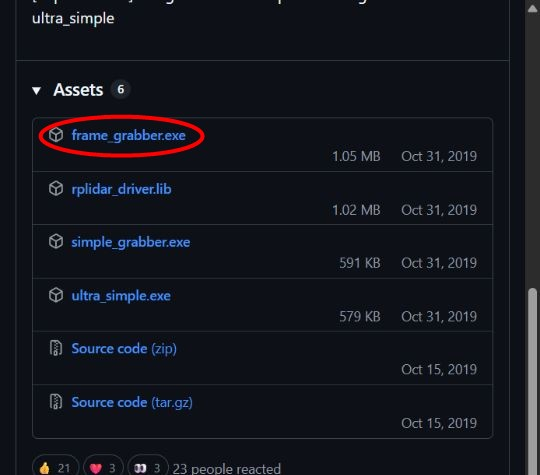

# Como testar o RPLIDAR A1M8-R5 no Windows com o Frame Grabber

Use este tutorial para ver ao vivo os pontos medidos pelo **Slamtec RPLIDAR A1M8-R5** e comparar uma distância com a trena. Você vai usar o Windows e o próprio cabo USB do sensor.

## Configuração em que o teste funcionou

| Item | Configuração usada |
| --- | --- |
| Computador | Windows 11 25H2, 64 bits (x64), build 26200.9457 |
| LiDAR | Slamtec RPLIDAR A1M8-R5, firmware 1.25, revisão de hardware 5 |
| Conexão | Cabo USB ligado ao computador pelo adaptador USB–serial Silicon Labs CP2102 |
| Driver | CP210x Universal Windows Driver da Silicon Labs |
| Aplicativo | Frame Grabber v1.12.0 para Windows |
| Comunicação serial | COM3, 115200 baud |

O Frame Grabber foi executado diretamente no Windows. O Ubuntu 22.04, o WSL, o ROS 2 e o RoboStudio são dispensáveis para este teste de bancada. Em outro computador, use a porta COM que aparecer no Gerenciador de Dispositivos. A versão do Windows e o firmware acima registram o ambiente testado. A compatibilidade com outras versões permanece sem verificação.

## 1. Conecte o LiDAR

1. Apoie o LiDAR numa mesa firme com a cabeça redonda para cima. Deixe a peça livre para girar e passe o cabo fora do caminho dela.
2. Com o cabo branco do sensor conectado ao adaptador USB–serial e a ponta pequena do cabo azul no adaptador, conecte a ponta USB grande ao computador.
3. Clique com o botão direito no botão **Iniciar** e abra **Gerenciador de Dispositivos**.
4. Abra **Portas (COM e LPT)** e procure **Silicon Labs CP210x USB to UART Bridge**. Anote a porta entre parênteses. No computador do teste ela era **COM3**.

**Se a porta não aparecer:** tire e recoloque o cabo USB e compare a lista do Gerenciador de Dispositivos.

### Se aparecer Código 28

Se o **CP2102** aparecer em **Outros dispositivos** com um triângulo amarelo, abra **Propriedades → Geral**. O **Código 28** indica que falta o driver.

1. Baixe o [driver oficial CP210x (.zip)](https://www.silabs.com/documents/public/software/CP210x_Universal_Windows_Driver.zip).
2. Na pasta **Downloads**, clique com o botão direito no ZIP e escolha **Extrair Tudo…**.
3. No Gerenciador de Dispositivos, clique com o botão direito no **CP2102** e escolha **Atualizar driver → Procurar drivers no meu computador**.
4. Selecione a pasta extraída, marque **Incluir subpastas** e clique em **Avançar**. Depois, volte a **Portas (COM e LPT)** e anote o número da porta.

## 2. Abra o Frame Grabber

1. Abra a [página oficial da versão 1.12.0](https://github.com/Slamtec/rplidar_sdk/releases/tag/release/v1.12.0). Role até **Assets** e, se a lista estiver fechada, clique em **Assets** para abrir. Clique em **frame_grabber.exe**, circulado em vermelho abaixo. No computador usado no teste, o arquivo já está em **Downloads**.

   
2. Feche o RoboStudio e qualquer outro programa que esteja usando a porta do sensor.
3. Abra **frame_grabber.exe**. Na opção de conexão serial, selecione a porta anotada, como **COM3**. Se aparecer o campo **Baud rate**, use **115200**. Conecte e inicie a varredura.
   Se a porta não abrir, confirme o número da COM no Gerenciador de Dispositivos e feche outros programas que possam estar usando a porta.

4. Veja se a cabeça gira e se aparecem pontos na tela. Mova uma caixa na altura do laser e observe se os pontos acompanham a caixa.

   Se a tela ficar sem pontos, confira a porta, a velocidade de 115200, se a varredura foi iniciada e se a cabeça gira.

## 3. Compare com a trena (opcional)

1. Deixe o LiDAR parado diante de uma parede lisa e fosca. Meça em linha perpendicular **do centro da cabeça redonda até a parede**. Uma distância perto de 1 m é um bom ponto de partida.
2. Na tela, identifique a linha de pontos da parede. Se houver escala visível, compare a distância mais curta do centro do gráfico até a linha com o valor da trena. Anote os dois valores. Se a escala não estiver clara, guarde um print inteiro com a medida anotada.
3. Para confirmar que escolheu a linha certa, afaste o LiDAR **30 cm** da parede, mantendo a mesma orientação. Confira se a linha se afasta aproximadamente a mesma distância. Repita em outra posição para avaliar a precisão.

## Resumo

- Conecte o adaptador e confira a **porta COM** no Windows.
- Abra o **Frame Grabber** e use a porta encontrada e **115200 baud**.
- Mova uma caixa para ver os pontos ao vivo e, se quiser conferir a distância, use uma parede e uma trena.
- A tela mostra a varredura vista de cima. O mapa do Hemabot é testado depois, com o sensor montado e o robô em movimento.
